# `pjrt_paras` v0.1 Technical Design & Execution Flow

This document is the complete technical reference for **`pjrt_paras` v0.1** under `pjrt_plugin/` in `Framework-Torch-ParaS`. It covers the architecture, file-to-file execution flow, verified AMD MI300X (`gfx942`) bring-up, and the roadmap from **v0.1 → v1.0**.

---

## 1. What v0.1 Proved (Verified on 8× AMD Instinct MI300X `gfx942`)

- **Zero PyTorch Linkage:** `libpjrt_paras.so` has zero `libtorch`, `libc10`, or `pybind11` dependencies and exports `GetPjrtApi` directly.
- **Direct PJRT C API (Option A):** Implements `pjrt_c_api.h` directly in C++ without `libxla` or `pjrt_c_api_wrapper_impl.h`.
- **End-to-End JAX Execution on ParaS + CLAP:**
  - `jax.devices()` enumerates all 8 `ParaSDevice(id=0..7, name=AMD Instinct MI300X)` GPUs via SYCL (`parascc -parasdevice hip:gfx942`).
  - `jax.jit` MatMul passes `np.testing.assert_allclose(..., rtol=1e-4, atol=1e-4)` across repeated iterations for:
    - `square_64`: `(64, 64) @ (64, 64)`
    - `rect_128_256_64`: `(128, 256) @ (256, 64)`
    - `trans_rhs_128_256_64`: `(128, 256) @ (64, 256).T` (including `stablehlo.transpose` + `stablehlo.dot_general`)

---

## 2. End-to-End Execution Flowchart

```mermaid
flowchart TD
    A["Python: test_matmul.py<br/>import jax; JAX_PLATFORMS=paras"] --> B["pyproject.toml entry_points<br/>jax_plugins: paras = jax_paras_plugin"]
    B --> C["jax_paras_plugin/__init__.py<br/>initialize() -> xb.register_plugin('paras', libpjrt_paras.so)"]
    C --> D["pjrt_api.cpp: GetPjrtApi()<br/>Returns PJRT_Api table"]
    D --> E["pjrt_api.cpp: PJRT_Plugin_Initialize & PJRT_Client_Create<br/>-> paras_pjrt_sycl.cpp: init_runtime()"]
    E --> F["paras_pjrt_sycl.cpp: sycl::device::get_devices(gpu)<br/>Creates in-order sycl::queue per MI300X<br/>-> paras_pjrt_clap.cpp: clap_init_backend() (CLAP_BACKEND=AMD)"]

    F --> G["Python: jnp.asarray(a_np), jnp.asarray(b_np)"]
    G --> H["pjrt_buffer.cpp: PJRT_Client_BufferFromHostBuffer<br/>-> paras_pjrt_sycl.cpp: sycl::malloc_shared + queue.memcpy(H2D)<br/>-> pjrt_event.cpp: PJRT_Event_OnReady"]

    H --> I["Python: jax.jit(lambda x, y: x @ y.T)(a_jax, b_jax)<br/>JAX traces jaxpr -> lowers to VHLO/StableHLO bytecode (ML\\xefR)"]
    I --> J["pjrt_compile.cpp: PJRT_Client_Compile<br/>Writes /tmp/paras_pjrt_mlir_XXXXXX<br/>Deserializes VHLO -> MLIR text via stablehlo.deserialize_portable_artifact<br/>Parses shapes, transpose, dot_general -> MatMulPlan"]

    J --> K["pjrt_executable.cpp: PJRT_LoadedExecutable_Execute<br/>Allocates output buffer (sycl::malloc_shared)<br/>-> paras_pjrt_sycl.cpp: gemm_f32()"]
    K --> L["paras_pjrt_sycl.cpp: queue.wait() (pre-GEMM)<br/>-> paras_pjrt_clap.cpp: clap_gemm_f32_raw()<br/>ColMajor C^T = op(B)^T * op(A)^T via libclap.so<br/>hipDeviceSynchronize() -> queue.wait() (post-GEMM)"]

    L --> M["Python: np.asarray(out)<br/>pjrt_buffer.cpp: PJRT_Buffer_ToHostBuffer (2-phase: dst==nullptr size query, then D2H)<br/>-> paras_pjrt_sycl.cpp: queue.wait() + queue.memcpy(D2H)"]
    M --> N["Python: np.testing.assert_allclose(out_np, expected) -> PASS"]
```

---

## 3. File-to-File Execution Trace

### Stage 1: Plugin Discovery & Initialization
1. **[pyproject.toml](file:///home/kilaruvd/Framework-Torch-ParaS/pjrt_plugin/pyproject.toml)** registers `paras = "jax_paras_plugin"` under `[project.entry-points."jax_plugins"]`.
2. **[python/jax_paras_plugin/\_\_init\_\_.py](file:///home/kilaruvd/Framework-Torch-ParaS/pjrt_plugin/python/jax_paras_plugin/__init__.py)** runs `initialize()`, locates `libpjrt_paras.so`, and calls `xb.register_plugin("paras", priority=500, library_path=..., options=None)`.
3. **`jaxlib`** `dlopen`s `libpjrt_paras.so` and calls **`GetPjrtApi()`** in **[csrc/pjrt_api.cpp](file:///home/kilaruvd/Framework-Torch-ParaS/pjrt_plugin/csrc/pjrt_api.cpp)**.
4. **`jaxlib`** calls `PJRT_Plugin_Initialize` and `PJRT_Client_Create` in **[csrc/pjrt_api.cpp](file:///home/kilaruvd/Framework-Torch-ParaS/pjrt_plugin/csrc/pjrt_api.cpp)**, which calls `paras_pjrt::init_runtime()` in **[csrc/paras_pjrt_sycl.cpp](file:///home/kilaruvd/Framework-Torch-ParaS/pjrt_plugin/csrc/paras_pjrt_sycl.cpp)**:
   - Enumerates GPUs via `sycl::device::get_devices(sycl::info::device_type::gpu)` and creates an in-order `sycl::queue` for each device.
   - Calls `clap_init_backend()` in **[csrc/paras_pjrt_clap.cpp](file:///home/kilaruvd/Framework-Torch-ParaS/pjrt_plugin/csrc/paras_pjrt_clap.cpp)**, setting `CLAP_BACKEND=AMD` (or `CUDA` / `CPU`) if unset and creating `clap::BlasFactory::create()`.
5. **`jaxlib`** queries `PJRT_Client_TopologyDescription`, `PJRT_TopologyDescription_*`, `PJRT_Client_Devices`, `PJRT_Device_GetDescription`, and `PJRT_Device_DefaultMemory` (all implemented in **[csrc/pjrt_api.cpp](file:///home/kilaruvd/Framework-Torch-ParaS/pjrt_plugin/csrc/pjrt_api.cpp)** using `Paras*` opaque backing structs from **[csrc/pjrt_types.hpp](file:///home/kilaruvd/Framework-Torch-ParaS/pjrt_plugin/csrc/pjrt_types.hpp)**).

### Stage 2: Host-to-Device Input Placement (`jnp.asarray`)
1. **`jaxlib`** calls `PJRT_Client_BufferFromHostBuffer` in **[csrc/pjrt_buffer.cpp](file:///home/kilaruvd/Framework-Torch-ParaS/pjrt_plugin/csrc/pjrt_buffer.cpp)**.
2. `paras_pjrt::alloc_device()` in **[csrc/paras_pjrt_sycl.cpp](file:///home/kilaruvd/Framework-Torch-ParaS/pjrt_plugin/csrc/paras_pjrt_sycl.cpp)** allocates USM via `sycl::malloc_shared<std::byte>(nbytes, *slot->queue)`.
3. Non-contiguous host arrays are packed if needed; `paras_pjrt::copy_h2d()` copies to USM via `queue->memcpy(...)` + `queue->wait()`.
4. Returns a `PJRT_Buffer*` (`ParasBuffer`) and a ready `PJRT_Event*` (`ParasEvent`), whose `PJRT_Event_OnReady` callback in **[csrc/pjrt_event.cpp](file:///home/kilaruvd/Framework-Torch-ParaS/pjrt_plugin/csrc/pjrt_event.cpp)** fires immediately.

### Stage 3: Graph Compilation (`jax.jit` → `PJRT_Client_Compile`)
1. `jaxlib` checks `PJRT_Device_MemoryStats` in **[csrc/pjrt_api.cpp](file:///home/kilaruvd/Framework-Torch-ParaS/pjrt_plugin/csrc/pjrt_api.cpp)** and calls `PJRT_Client_Compile` in **[csrc/pjrt_compile.cpp](file:///home/kilaruvd/Framework-Torch-ParaS/pjrt_plugin/csrc/pjrt_compile.cpp)** with a serialized VHLO/StableHLO bytecode payload (`ML\xefR`).
2. `deserialize_mlir_bytecode()` writes `/tmp/paras_pjrt_mlir_XXXXXX`, invokes `JAX_PLATFORMS=cpu python` with `mlir.make_ir_context()` + `stablehlo.deserialize_portable_artifact(ctx, data)` (or `stablehlo-translate` / `mlir-opt` if present), and unlinks the temp file.
3. `parse_stablehlo_matmul()` extracts `tensor<DxDxf32>` shapes, `stablehlo.dot_general` `contracting_dims`, and any `stablehlo.transpose` on `%arg0`/`%arg1`, producing a `MatMulPlan` (`m`, `n`, `k`, `trans_a`, `trans_b`, `out_dims`) inside `ParasLoadedExecutable`.
4. `jaxlib` queries `PJRT_Executable_NumOutputs`, `NumReplicas`, `NumPartitions`, `ParameterMemoryKinds`, `OutputMemoryKinds`, and `OptimizedProgram` (returns `UNIMPLEMENTED`, handled gracefully by `jaxlib`) in **[csrc/pjrt_executable.cpp](file:///home/kilaruvd/Framework-Torch-ParaS/pjrt_plugin/csrc/pjrt_executable.cpp)**.

### Stage 4: Execution & Output Retrieval (`PJRT_LoadedExecutable_Execute` → `ToHostBuffer`)
1. `loaded_executable_execute()` in **[csrc/pjrt_executable.cpp](file:///home/kilaruvd/Framework-Torch-ParaS/pjrt_plugin/csrc/pjrt_executable.cpp)** allocates the output `ParasBuffer` (`M * N * sizeof(float)`) via `paras_pjrt::alloc_device()`.
2. Calls `paras_pjrt::gemm_f32()` in **[csrc/paras_pjrt_sycl.cpp](file:///home/kilaruvd/Framework-Torch-ParaS/pjrt_plugin/csrc/paras_pjrt_sycl.cpp)**:
   - Calls `synchronize_device()` (`sycl::queue::wait()`).
   - Calls `clap_gemm_f32_raw()` in **[csrc/paras_pjrt_clap.cpp](file:///home/kilaruvd/Framework-Torch-ParaS/pjrt_plugin/csrc/paras_pjrt_clap.cpp)**:
     - Computes row-major $C_{M \times N} = \text{op}_A(A) \cdot \text{op}_B(B)$ via `backend->gemm(clap::Layout::ColMajor, ...)` as $C^T_{N \times M} = \text{op}_B(B)^T \cdot \text{op}_A(A)^T$.
     - Synchronizes the vendor runtime via `hipDeviceSynchronize()` (or `cudaDeviceSynchronize()`).
   - Calls `synchronize_device()` (`sycl::queue::wait()`).
3. On `np.asarray(out)`, `jaxlib` calls `PJRT_Buffer_ToHostBuffer` in **[csrc/pjrt_buffer.cpp](file:///home/kilaruvd/Framework-Torch-ParaS/pjrt_plugin/csrc/pjrt_buffer.cpp)** twice:
   - Pass 1 (`dst == nullptr`): returns `dst_size = buf->byte_size`.
   - Pass 2 (`dst != nullptr`): calls `paras_pjrt::copy_d2h()` (`queue.wait()`, `queue.memcpy(D2H)`, `queue.wait()`) and returns a ready `PJRT_Event*`.

---

## 4. Build Split & Key Technical Lessons from v0.1

| File | Compiler | Reason |
|---|---|---|
| `csrc/paras_pjrt_sycl.cpp` | `parascc` (`-j1`) | Owns `<sycl/sycl.hpp>` (`sycl::queue`, `sycl::malloc_shared`); `parascc` rewrites main `.cpp` translation units, not headers. |
| `csrc/pjrt_*.cpp` | `parascc` (`-j1`) | Pure C++ implementing `pjrt_c_api.h` using `Paras*` opaque structs (avoids `PJRT_Error` / `PJRT_Memory` struct redefinitions in `pjrt_c_api.h`). |
| `csrc/paras_pjrt_clap.cpp` | Host `g++` | Isolates `<clap/blas_factory.hpp>` from `parascc` and forward-declares `hipDeviceSynchronize()` / `cudaDeviceSynchronize()` to avoid `clap/blas/types.hpp` enum/typedef collisions with `hip_runtime_api.h`. |

---

## 5. Future Direction: v0.1 → v1.0

1. **In-Process StableHLO / MLIR C++ Parsing (Remove Subprocess):**
   - Replace the `popen` + `python` / `/tmp/paras_pjrt_mlir_XXXXXX` deserialization in `pjrt_compile.cpp` with in-process MLIR/StableHLO C++ linking (or a lightweight C++ VHLO/StableHLO reader) to eliminate cold-compile latency and remove the runtime `python`/`stablehlo-translate` dependency.
2. **Memory Pool & Device-Only Allocations:**
   - Port the `MemoryPool` caching pattern from `csrc/core/allocator.cpp` and switch from `sycl::malloc_shared` to `sycl::malloc_device` for non-host-visible intermediates, reducing allocation overhead and PCIe/XGMI traffic.
3. **Async Execution & Real `PJRT_Event` Integration:**
   - Replace synchronous `queue.wait()` + `hipDeviceSynchronize()` around every GEMM with stream-ordered execution and async `PJRT_Event` completion callbacks so JAX can overlap H2D, compute, and D2H.
4. **Multi-Op StableHLO Support (CLAP + SYCL + Triton):**
   - **CLAP-BLAS & CLAP-DNN:** Lower `dot_general` (batched, `fp16`/`bf16`/`fp64`), `convolution`, `batch_norm` to `libclap`.
   - **ParaS SYCL Kernels:** Lower standalone elementwise/reduction/indexing ops to SYCL kernels compiled with `parascc`.
   - **Triton (`clap-triton` / `jax-triton`):** Add a vendor kernel-launcher in `CLAP-Library` (`cuModuleLaunchKernel` / `hipModuleLaunchKernel`) to execute Triton-compiled `.cubin`/`.hsaco` fused kernels and `stablehlo.custom_call` directly on ParaS USM buffers.
5. **Repo & Packaging Architecture (`torch-ai-paras` / MCA Route):**
   - Extract the shared ParaS SYCL runtime + memory pool + CLAP adapters into a framework-agnostic C++ core (`libparas_ai_core.so`), with **zero-cross-linkage** thin frontends:
     - PyTorch frontend (`_C.so`)
     - JAX PJRT frontend (`libpjrt_paras.so` in standalone `Framework-JAX-ParaS` or unified `torch-ai-paras` workspace)
6. **Multi-GPU & Collectives:**
   - Expose all 8 MI300X GPUs for `pmap` / `pjit` (`num_devices > 1` in `PJRT_LoadedExecutable_Execute`) and integrate RCCL/NCCL for `all_reduce` / `all_gather`.
